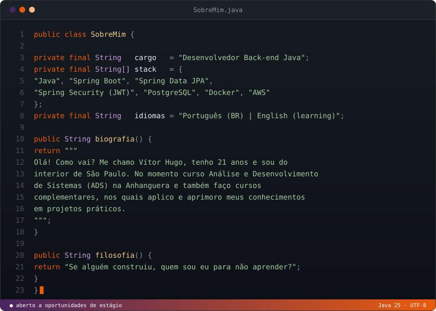
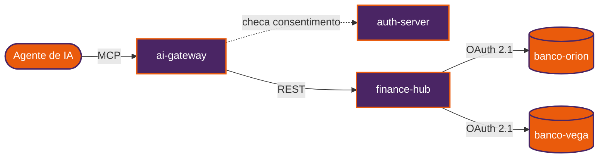

<!-- ============ BANNER ============ -->

<!-- ============ DIGITAÇÃO ============ -->

  

<!-- ============ CONTATOS ============ -->

  
  

 

  

 
## `Projeto em destaque`
 
> Ecossistema de Open Finance simulado: dois bancos fictícios, um servidor de autorização que controla o consentimento do cliente, um agregador financeiro e um assistente de IA que só acessa dados com consentimento válido e sob auditoria.
 
🔗 **[Ver repositório](https://github.com/vitoralemaorb/openfinance-lab)**
 
### `Arquitetura`
 

 
<!-- ============ RODAPÉ ============ -->

 
